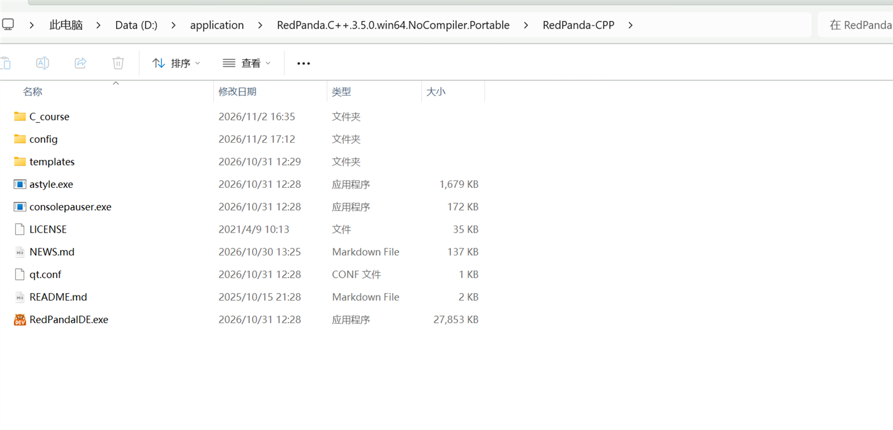
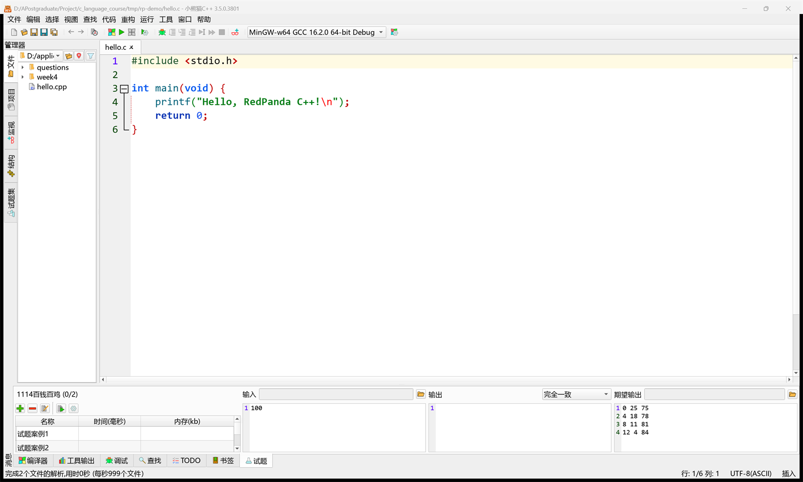
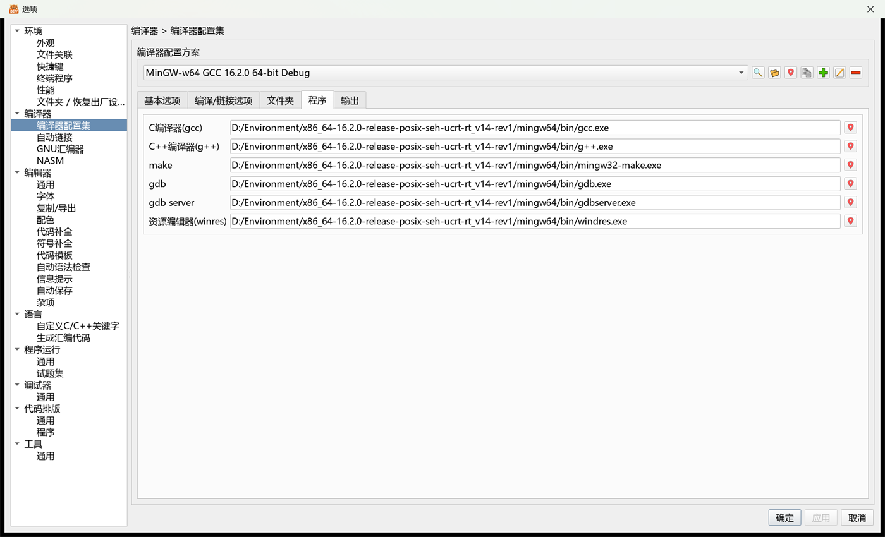
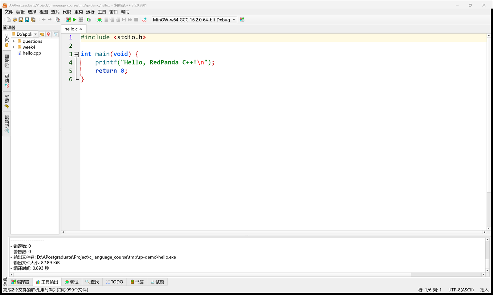
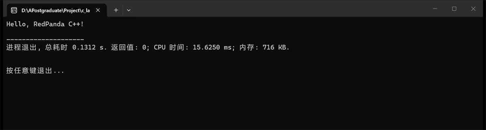
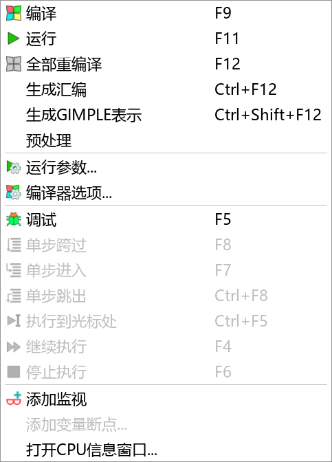
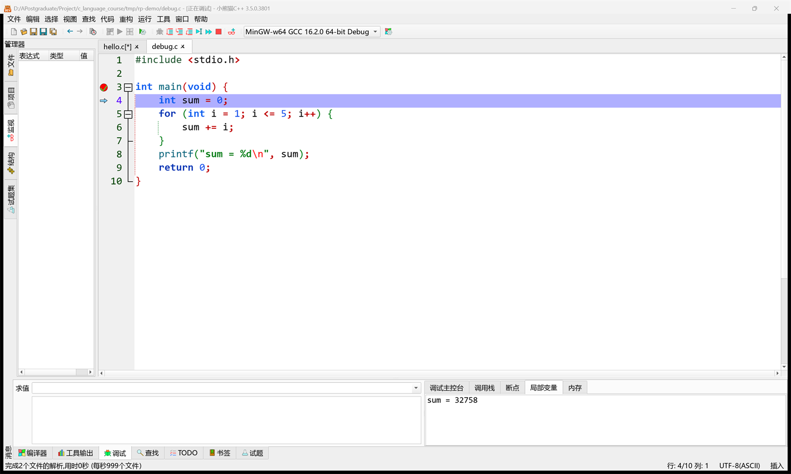
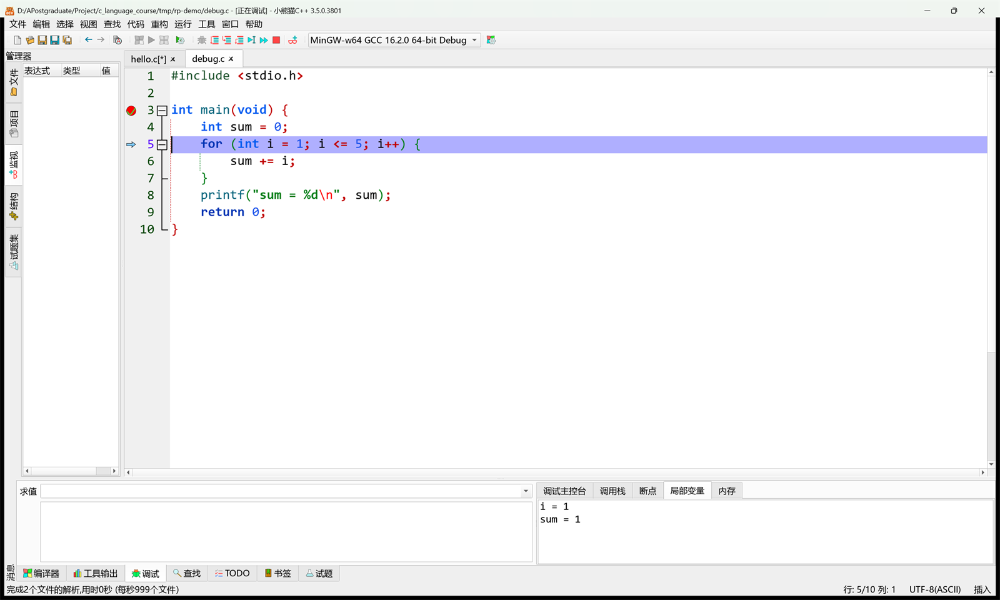
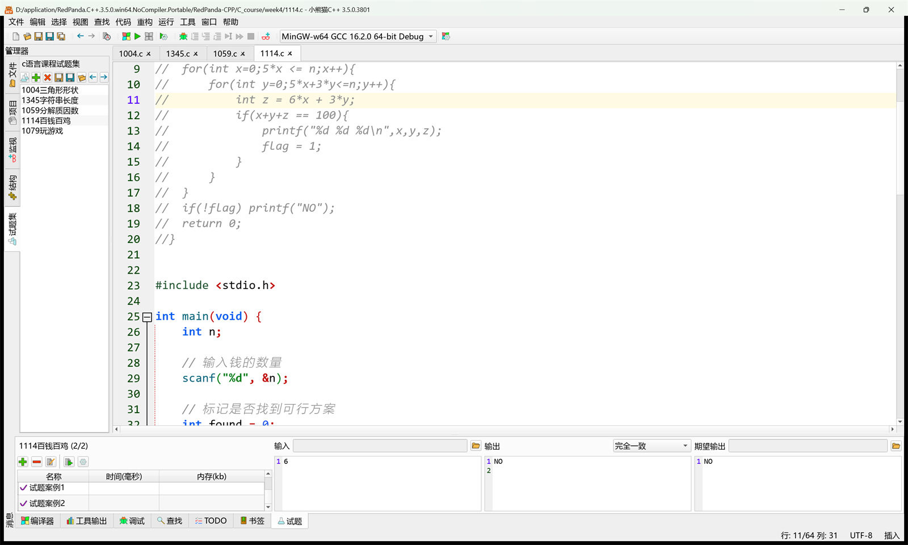
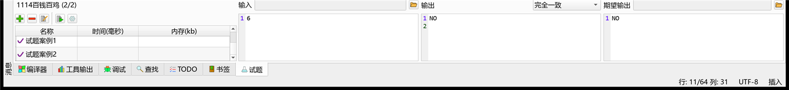

# 第五周 · RedPandaIDE（小熊猫 C++）的安装与使用

> **参考文献**
> [《小熊猫C++下载》](http://royqh.net/redpandacpp/download/) —— 瞿华，发布于 小熊猫C++官网，抓取日期 2026-11-02
> [《小熊猫C++ 3.5发布》](http://royqh.net/redpandacpp/blog/2026/10/31/version.3.5/) —— 瞿华，发布于 小熊猫C++官网，抓取日期 2026-11-02
> [《RedPanda-CPP》](https://github.com/royqh1979/RedPanda-CPP) —— 瞿华（royqh1979），发布于 GitHub，抓取日期 2026-11-02
> [《OJ与试题集功能》](http://royqh.net/redpandacpp/blog/2022/02/04/problemset/) —— 瞿华，发布于 小熊猫C++官网，抓取日期 2026-11-02
>
> 本文的操作步骤依据小熊猫 C++ 官方发布说明、下载页与官方仓库整理；**文中 10 张截图均为助教在本机 RedPanda C++ 3.5.0（Windows 11）上实际截取**，不来自上述参考文献，版权归本课程所有。
> **注意：官网同时提供"带编译器"的安装版和"不带编译器"的版本，而本课程实际使用的是 `win64 NoCompiler` 绿色版 + 第一周已经装好的 GCC 16.2.0。** 两者在安装方式、编译器来源和 gcc 路径上都不同，第 3.3 节会列表对比，**一切以本文档（课程实际环境）为准**。

---

## 0. 本节目标

学完并动手做完本文档，你应该能够：

- 说清 **IDE、编译器、调试器** 分别是什么，以及为什么 RedPandaIDE 装好了还要单独设置 GCC；
- 独立解压并启动 **小熊猫 C++ 3.5.0（NoCompiler 绿色版）**，找到并运行 `RedPandaIDE.exe`；
- 在「**工具 → 选项 → 编译器 → 编译器配置集**」里，把 `gcc.exe`、`g++.exe`、`gdb.exe` 指向第一周装好的那套 GCC，并验证编译成功；
- 用 **F9 编译、F11 运行**，用 **F5 调试、F8 单步**，会在断点处查看变量的当前值；
- 打开课程的 `questions.pbs` **试题集**，运行所有测试案例，看懂 `(2/2)`、绿色 √ 和红色 × 分别代表什么。

> [!IMPORTANT]
> 本周不是"再装一个 VS Code"。
> 第一周的 VS Code 是**通用编辑器 + 插件**，需要自己写 `tasks.json` 和 `launch.json`；小熊猫 C++ 是**专门给 C/C++ 初学者用的 IDE**，编译器、调试器、运行按钮都集中在一个界面里，适合课堂练习、考试和快速验证。
> 两者可以**同时装在电脑上**，互不冲突；但**编译器只用第一周那一套**，不要再装第二套 GCC。

---

## 1. 课前准备

| 需要的东西                                            | 从哪来                                                                    | 大概多大 / 多久                         |
| ----------------------------------------------------- | ------------------------------------------------------------------------- | --------------------------------------- |
| **小熊猫 C++ 3.5.0（win64 NoCompiler 绿色版）** | 官网「下载」页，或课程群里下发的同版本压缩包                              | 压缩包 **9.2 MB**，解压后约 32 MB |
| **第一周装好的 GCC 16.2.0**                     | 第一周已经装好，直接沿用                                                  | —                                      |
| 一个能解压 `.7z` 的软件                             | 7-Zip、Bandizip 等                                                        | 几 MB                                   |
| 一个纯英文、无空格的练习目录                          | 自己建，如 `D:\RedPanda-CPP`、`D:\Code\c-demo`                        | —                                      |
| 课程的 `questions.pbs`                              | 课程资料里的 `C_course/questions/` 文件夹（以你实际拿到的资料位置为准） | 约 59 KB                                |
| 联网（仅首次下载时需要）                              | 下载压缩包时使用                                                          | —                                      |

> [!WARNING]
> **解压路径里不要出现中文和空格。**
> 例如 `D:\我的文件\小熊猫\` 这种路径，容易让编译器、调试器找不到文件。请用 `D:\RedPanda-CPP` 这类纯英文路径。

> [!TIP]
> 你**不需要卸载第一周的 VS Code**。本周只是多一个更顺手的 C 语言练习工具；以后做多文件项目仍然可以用 VS Code + CMake。

---

## 2. 先分清三样东西：IDE、编译器、调试器

很多同学以为"装了 IDE 就等于装了编译器"，结果一编译就报错。先把这三个角色分清楚：

| 角色                          | 本课程对应的程序                     | 作用                                     | 本文在哪设置   |
| ----------------------------- | ------------------------------------ | ---------------------------------------- | -------------- |
| **IDE（集成开发环境）** | `RedPandaIDE.exe`                  | 提供编辑代码、按钮、面板、项目管理       | 解压后直接运行 |
| **编译器**              | `gcc.exe`（C）、`g++.exe`（C++） | 把 `.c` 源码翻译成 `.exe` 可执行文件 | 第 5 节        |
| **调试器**              | `gdb.exe`                          | 让程序在断点处停下来，单步执行、查看变量 | 第 5、7 节     |

小熊猫 C++ 的 **NoCompiler** 版本，顾名思义**只带 IDE，不带编译器**。它启动后必须知道"我的 gcc 在哪"，否则你点编译，它只会告诉你找不到编译器。

> [!IMPORTANT]
> 课程之所以选 NoCompiler 版，是因为你**第一周已经装好了 GCC 16.2.0**（`gcc`、`g++`、`gdb` 都在 `C:\mingw64\bin` 里）。
> 如果再装官网那个"自带编译器"的完整版，你的电脑上就会出现**两套 GCC**（一套 16.2.0，一套 15.3.0），以后查路径、查版本、查报错都会互相打架。

---

## 3. 下载与安装

### 3.1 下载哪个文件

打开官网下载页 [http://royqh.net/redpandacpp/download/](http://royqh.net/redpandacpp/download/)，页面会提供蓝奏云、百度云和 SourceForge 等入口。课程使用的文件是：

```text
RedPanda.C++.3.5.0.win64.NoCompiler.Portable.7z
```

官网 3.5 版本同时提供多种包，别下错：

| 文件名                                                  | 体积             | 说明                                                    |
| ------------------------------------------------------- | ---------------- | ------------------------------------------------------- |
| `RedPanda.C++.3.5.0.win64.NoCompiler.Portable.7z`     | **9.2 MB** | **课程使用**：64 位、绿色版、**不含编译器** |
| `RedPanda.C++.3.5.0.win64.NoCompiler.Setup.exe`       | 10.8 MB          | 64 位、安装版、不含编译器                               |
| `RedPanda.C++.3.5.0.win64.MinGW64_15.3.0.Portable.7z` | 59.2 MB          | 64 位、绿色版、**自带 GCC 15.3.0**                |
| `RedPanda.C++.3.5.0.win64.MinGW64_15.3.0.Setup.exe`   | 71.2 MB          | 64 位、安装版、**自带 GCC 15.3.0**                |

> [!TIP]
> 文件名里的 **win64** 表示 64 位 Windows；**NoCompiler** 表示不带编译器；**Portable** 表示绿色版，解压即用；**Setup** 表示安装版。
> 版本号 **3.5.0** 是 2026-10-31 发布的最新版；你的界面标题栏可能会显示 `3.5.0.3801` 这样的内部构建号，**只要大版本是 3.5 就一致**。

### 3.2 解压与首次启动

1. 用 7-Zip 或 Bandizip 解压 `RedPanda.C++.3.5.0.win64.NoCompiler.Portable.7z`，解压目标填一个**纯英文路径**，例如 `D:\`。
2. 解压完成后，进入 `RedPanda-CPP` 文件夹。你应该能看到 `RedPandaIDE.exe`、`consolepauser.exe`、`config`、`templates` 等文件和文件夹。


*图 1：解压后的 `RedPanda-CPP` 文件夹，`RedPandaIDE.exe` 就是启动程序（约 28 MB）*

3. 双击 `RedPandaIDE.exe` 启动。第一次启动可能稍慢，属于正常现象；之后会快很多。
4. 在 `RedPandaIDE.exe` 上右键 → **发送到** → **桌面快捷方式**，以后从桌面启动。

> [!NOTE]
> 绿色版**没有安装向导，也不写注册表**（配置保存在程序目录的 `config` 文件夹里）。
> 想"卸载"时，直接关掉程序、删除整个 `RedPanda-CPP` 文件夹即可，不会残留。

> [!WARNING]
> **不要删除 `consolepauser.exe`。**
> 它负责在程序运行结束后显示"按任意键退出"，没有它，运行窗口可能一闪而过。

### 3.3 与官网安装版的环境差异

官网也提供"自带编译器"的安装版，本课程用的是 NoCompiler 绿色版 + 第一周的 GCC。两者的对应关系如下：

| 对比项   | 官网带编译器的安装版                                  | **本课程实际使用**                            |
| -------- | ----------------------------------------------------- | --------------------------------------------------- |
| 文件名   | `RedPanda.C++.3.5.0.win64.MinGW64_15.3.0.Setup.exe` | `RedPanda.C++.3.5.0.win64.NoCompiler.Portable.7z` |
| 体积     | 71.2 MB                                               | **9.2 MB**                                    |
| 安装方式 | 运行安装向导，下一步下一步                            | **解压即用**，删文件夹即卸载                  |
| 编译器   | 自带 **GCC 15.3.0**                             | 复用第一周的 **GCC 16.2.0**                   |
| gcc 路径 | 安装目录下的 `mingw64\bin`                          | 第一周的 `C:\mingw64\bin`（以你机器为准）         |
| 调试器   | 自带 `gdb.exe`                                      | 第一周工具链里的 `gdb.exe`（版本 17.2）           |
| 适合谁   | 完全没装过 GCC 的同学                                 | **本课程**（第一周已装好 GCC）                |

> [!IMPORTANT]
> **以本文档为准，参考文献（官网）仅供参考。**
> 如果你出于好奇装了官网的完整版，你的 gcc 路径会是"安装目录\mingw64\bin"，而不是 `C:\mingw64\bin`。第 5 节填路径时，**以你自己电脑上实际放着 `gcc.exe` 的那个 `bin` 文件夹为准**，不要照抄图里的盘符。

---

## 4. 第一次启动：界面分区

启动后，你会看到类似下面的界面。先不用急着写代码，花两分钟认一认各个区域：


*图 2：主界面由菜单栏、工具栏、左侧管理器、中间编辑器、底部消息区组成；注意右上角的编译器配置集下拉框*

| 区域                   | 位置         | 作用                                                                                        |
| ---------------------- | ------------ | ------------------------------------------------------------------------------------------- |
| **菜单栏**       | 最上方       | **文件**、**编辑**、**运行**、**工具**、**帮助** 等           |
| **工具栏**       | 菜单栏下方   | 新建、保存、编译、运行、调试等快捷按钮                                                      |
| **编译器配置集** | 右上角下拉框 | 显示当前使用的编译器，如 `MinGW-w64 GCC 16.2.0 64-bit Debug`                              |
| **管理器**       | 左侧         | **文件**、**项目**、**监视**、**结构**、**试题集** 五个标签页 |
| **编辑器**       | 中间         | 写代码；左侧是行号栏，点行号左边可以打**断点**                                        |
| **消息区**       | 底部         | **编译器**（编译日志）、**调试**、**试题**、**查找** 等标签页       |
| **状态栏**       | 最下方       | 当前行号、列号、文件编码（UTF-8）、插入/改写状态                                            |

> [!TIP]
> 右上角那个下拉框非常重要。它显示的就是**当前生效的编译器配置集**。
> 如果它显示 `No compiler`、空白，或者显示的不是你刚设置的名称，说明第 5 节还没配置好。

> [!NOTE]
> 图 2 左侧的文件树和底部的"试题"面板，是助教机器上已经打开的课程目录；你刚启动时**左侧可能是空的、底部没有试题**，这是正常的，打开文件或试题集后才会出现。

---

## 5. 设置 GCC 编译器

### 5.1 先搞懂"编译器配置集"

小熊猫 C++ 把"用哪套编译器、带哪些编译选项"打包成一个**编译器配置集**（也叫编译器配置方案）。你可以有多个配置集，随时在右上角切换。

助教使用的这份课程包里预置了两个（如果你解压后下拉框里没有，按 5.3 节的提示新建一个）：

| 配置集                                  | 用途                    | 关键区别                                                   |
| --------------------------------------- | ----------------------- | ---------------------------------------------------------- |
| `MinGW-w64 GCC 16.2.0 64-bit Release` | 发布/交作业             | 优化较高，**不带调试信息**，体积小、跑得快           |
| `MinGW-w64 GCC 16.2.0 64-bit Debug`   | 日常学习/**调试** | 带调试信息（`-g`），**断点和单步才有效**，体积略大 |

一个配置集里至少要指定三个程序：

- **C 编译器** `gcc.exe` —— 编译 `.c`；
- **C++ 编译器** `g++.exe` —— 编译 `.cpp`；
- **调试器** `gdb.exe` —— 按 F5 调试时用。

`make`、`windres`、`gdb server` 是给项目和高级功能用的，能找到就一起填上，找不到也不影响单文件练习。

### 5.2 先找到你自己的 GCC

第一周你已经把 GCC 解压到了某个 `mingw64` 文件夹。本文统一按下面的路径举例：

```text
C:\mingw64\bin
```

如果你第一周是解压到 `D:\Environment\`（如图 3 的助教机器），你的路径可能是：

```text
D:\Environment\x86_64-16.2.0-release-posix-seh-ucrt-rt_v14-rev1\mingw64\bin
```

**判断标准只有一个**：这个 `bin` 文件夹里**直接**放着 `gcc.exe`、`g++.exe`、`gdb.exe`。打开文件夹确认一下，里面还应该有：

```text
gcc.exe
g++.exe
gdb.exe
gdbserver.exe
mingw32-make.exe
windres.exe
```

也可以在终端里验证（第一周的终端就能用）：

```bash
gcc --version
gdb --version
```

两条命令都能打印版本信息，说明工具链完整。本课程核对到的版本是 **GCC 16.2.0 / GDB 17.2**，你的版本号可能略有不同。

> [!WARNING]
> 路径**必须写到 `bin` 这一层**。
> 写成 `C:\mingw64` 或 `C:\mingw64\mingw64` 都不行，IDE 找不到里面的 `gcc.exe`。

### 5.3 在 IDE 里填路径

1. 打开菜单 **工具** → **选项**。
2. 在左侧树里依次展开 **编译器** → **编译器配置集**。
3. 在顶部的「**编译器配置方案**」下拉框里，选择 **`MinGW-w64 GCC 16.2.0 64-bit Debug`**（名称里的版本号可能不同，认准结尾的 **Debug**）。
4. 点击右侧的 **程序** 标签页。
5. 把下面 6 行路径改成**你自己电脑上的实际路径**。课程建议填成：

| 项目                          | 应填写的路径                        |
| ----------------------------- | ----------------------------------- |
| **C编译器(gcc)**        | `C:\mingw64\bin\gcc.exe`          |
| **C++编译器(g++)**      | `C:\mingw64\bin\g++.exe`          |
| **make**                | `C:\mingw64\bin\mingw32-make.exe` |
| **gdb**                 | `C:\mingw64\bin\gdb.exe`          |
| **gdb server**          | `C:\mingw64\bin\gdbserver.exe`    |
| **资源编辑器(windres)** | `C:\mingw64\bin\windres.exe`      |


*图 3：在「程序」页把六个程序指向你的 `mingw64\bin`；图中是助教的 `D:\Environment\...` 路径。**你的路径可能不同**，只要指向同一个 `bin` 文件夹即可*

6. 点击 **确定**（或 **应用**）保存。
7. 回到主界面，确认右上角的下拉框显示的是你刚才编辑的配置集名称。

> [!TIP]
> **如果你是从零新建配置集**（下拉框里没有现成的 Debug 项）：
> 点击配置集下拉框右侧的绿色 **+**，输入名称（例如 `我的 GCC Debug`），确定后按上面的表格填好 6 个路径；再到 **基本选项** 页，在「**编译时加入下列选项**」里加一行 `-g`，否则调试时断点可能不生效。
>
> 如果你用的是课程包里预置的 Debug 配置集，它已经带调试信息，**只需要改路径，不要清空「基本选项」里原有的 `-D_DEBUG`**。

> [!IMPORTANT]
> 图 3 里的路径是助教机器的 `D:\Environment\...`，**不是让你照抄**。
> 你的路径大概率是 `C:\mingw64\bin\...`。填完后，点每行末尾的定位图标可以浏览确认文件真实存在。

### 5.4 验证配置是否成功

1. 打开一个最简单的 `.c` 文件（下一节会创建 `hello.c`）。
2. 按 **F9** 编译。
3. 看底部「**编译器**」标签页：
   - `错误数: 0`
   - `警告数: 0`
   - `输出文件名: ...\hello.exe`

只要能看到 `hello.exe` 的路径，就说明 gcc 配置成功。如果报"找不到 gcc"或"无法启动编译器"，回到 5.3 检查路径，重点看：

- 路径是不是写到了 `bin` 这一层；
- `gcc.exe` 是否真的存在；
- 是否把 `C:\mingw64\mingw64\bin` 多套了一层（第一周解压时常见）。

---

## 6. 写第一个程序：编译与运行

### 6.1 新建源文件

1. 菜单 **文件** → **新建** → **源文件**（也可以按 **Ctrl + N**）。
2. 按 **Ctrl + S** 保存，文件名填 `hello.c`，保存到纯英文目录（例如 `D:\Code\c-demo\hello.c`）。
3. 注意扩展名用 **`.c`**，不要用 `.cpp`：本课程是 C 语言，`.c` 才会按 C 标准编译。

输入下面的完整代码：

```c
#include <stdio.h>

int main(void) {
    printf("Hello, RedPanda C++!\n");
    return 0;
}
```

> [!TIP]
> `int main(void)` 表示 main 函数不接收命令行参数；结尾必须 `return 0;`。
> 这两点是本课程的代码规范，后面所有作业都按这个格式写。

### 6.2 F9 编译

按 **F9**（或菜单 **运行** → **编译**）。编译成功后，底部「编译器」面板会显示：

```text
- 错误数: 0
- 警告数: 0
- 输出文件名: D:\Code\c-demo\hello.exe
- 输出文件大小: 82.89 KiB
- 编译时间: 0.893 秒
```


*图 4：F9 编译成功，底部显示错误数 0、警告数 0，并给出生成的 `hello.exe` 路径*

> [!NOTE]
> 图中的 `82.89 KiB`、`0.893 秒` 是助教机器上的数字；**你的文件名、大小、时间可能不同，只要错误数是 0 就说明成功**。

### 6.3 F11 运行

按 **F11**（或菜单 **运行** → **运行**）。IDE 会启动一个控制台窗口，显示：

```text
Hello, RedPanda C++!
--------------------------------
进程退出, 总耗时 0.1312 s. 返回值: 0; CPU 时间: 15.6250 ms; 内存: 716 KB.

按任意键退出...
```


*图 5：F11 运行后，控制台窗口输出 `Hello, RedPanda C++!`，并显示退出码、耗时和"按任意键退出"*

按任意键关闭控制台，回到 IDE。

### 6.4 常用快捷键

打开菜单 **运行**，可以看到每个操作对应的快捷键：


*图 6：「运行」菜单里直接标出了 F9、F11、F5、F8 等快捷键*

| 操作                 | 快捷键              | 说明                             |
| -------------------- | ------------------- | -------------------------------- |
| **编译**       | **F9**        | 只编译，不运行；有错会在底部列出 |
| **运行**       | **F11**       | 编译（如有需要）并运行           |
| **全部重编译** | **F12**       | 清掉旧目标文件，从头编译         |
| **调试**       | **F5**        | 进入调试，需要 Debug 配置集      |
| **单步跨过**   | **F8**        | 执行当前行，遇到函数调用不进去   |
| **单步进入**   | **F7**        | 进入函数内部                     |
| **单步跳出**   | **Ctrl + F8** | 从当前函数返回到调用处           |
| **继续执行**   | **F4**        | 从当前断点继续跑到下一个断点     |
| **停止执行**   | **F6**        | 结束本次调试/运行                |

> [!WARNING]
> **不要直接双击 `hello.exe` 来运行。**
> 那样程序结束窗口会立刻关闭，看不到输出。请用 IDE 里的 **F11**，它调用 `consolepauser.exe` 帮你停住窗口。

---

## 7. 调试：让程序停下来给你看

### 7.1 为什么必须用 Debug 配置集

调试需要编译器在 `.exe` 里写入"哪条机器指令对应源码第几行、变量叫什么"的**调试信息**。Release 配置集为了优化和体积，通常不写这些信息，结果就是：

- 断点打不上，或者打上了也停不住；
- 变量显示 `<optimized out>`；
- 单步时行号乱跳。

所以调试前，先看右上角的下拉框，确认是 **`... 64-bit Debug`**。不是的话，点下拉框切换过去。

### 7.2 写一个用来调试的程序

新建 `debug.c`，输入：

```c
#include <stdio.h>

int main(void) {
    int sum = 0;
    for (int i = 1; i <= 5; i++) {
        sum += i;
    }
    printf("sum = %d\n", sum);
    return 0;
}
```

保存后按 **F9** 编译一次，确认没有错误。

### 7.3 打断点

1. 在编辑器左侧的**行号栏**，找到你想让程序停下的那一行。
2. 在行号**左边**的灰色区域点一下，会出现一个**红点**，这就是断点。
3. 再点一下红点可以取消断点。

本文在 `int main(void) {` 这一行（第 3 行）左侧打了断点，用来观察程序刚进入 main 时的状态。你也可以在第 6 行 `sum += i;` 左侧打一个断点，效果更直观——程序会在每次循环体执行前停下来。

### 7.4 F5 启动调试

按 **F5**。IDE 会先用 Debug 配置集编译，然后启动 gdb：

- 程序停在断点处，**蓝色高亮行**是"即将执行的那一行"；
- 左侧面板自动切换到「**监视**」，显示"表达式 / 类型 / 值"三列；
- 底部出现「**调试控制台**」，并多出 **调用栈**、**断点**、**局部变量**、**内存** 等标签页；
- 顶部工具栏的调试按钮变亮，可以单步、继续、停止。


*图 7：断点打在 `int main` 行，F5 后程序停在 main 入口；蓝色高亮的是即将执行的 `int sum = 0;`*

> [!NOTE]
> 图 7 的调试控制台里显示 `sum = 32758`，这是**正常的**：此刻第 4 行 `int sum = 0;` 还没执行，`sum` 是未初始化的随机值。
> 按一次 F8 执行完第 4 行后，它就会变成 0。

### 7.5 单步执行与查看变量

在断点停住后，常用三个动作：

- **F8 单步跨过**：执行当前行，若当前行调用函数，不进入函数内部；
- **F7 单步进入**：进入函数内部；
- **Ctrl + F8 单步跳出**：从当前函数返回到调用处。

连续按 **F8**，你会看到蓝色高亮行一行一行往下走，底部「调试控制台」里的变量值也会跟着变化：


*图 8：连续按 F8 后执行到循环处，调试控制台显示 `i = 1`、`sum = 1`*

想同时盯住多个变量，可以用菜单 **运行 → 添加监视**（或点调试工具栏的「**添加监视**」按钮），输入表达式 `sum`、`i`，回车后它会在每次单步时刷新当前值。也可以点底部的「**局部变量**」标签页，查看当前函数的所有局部变量。

调试结束后，按 **F6**（停止执行）退出调试；或者按 **F4** 继续执行到程序自然结束。

> [!TIP]
> 调试时常用的三个键：**F5 开始 → F8 单步 → F6 停止**。
> 如果只想让程序跑到光标所在行，用 **Ctrl + F5**（执行到光标处）；想跳过前面的循环，在目标行打个断点再按 **F4** 继续。

---

## 8. 试题集（测试集）的用法

### 8.1 先搞清几个名词

小熊猫 C++ 的官方叫法是「**试题集**」，有些同学也把它叫"测试集""题目集"，指的都是同一个功能。

| 名词                   | 含义                                                                   |
| ---------------------- | ---------------------------------------------------------------------- |
| **试题集**       | 一个 `.pbs` 文件，里面装着一批试题；课程文件是 `questions.pbs`     |
| **试题**         | 一道具体的题，例如 `1004三角形形状`                                  |
| **试题案例**     | 一道题的一组测试数据，包含**输入**和**期望输出**           |
| **运行所有案例** | 把你的程序对每组输入各跑一遍，自动比较实际输出和期望输出               |
| **完全一致**     | 比较方式：实际输出必须和期望输出**逐字符相同**（包括空格、换行） |

试题集**只保存题目和测试数据，不保存你的答案代码**。你的 `.c` 文件是单独存在的，IDE 运行的是你编译出来的 `.exe`。

> [!NOTE]
> `.pbs` 文件本质是一个 JSON 文本文件，里面存着题目描述、输入和期望输出。**不要用记事本手改它**，改坏了试题集会打不开；要改题目，用 IDE 里的「试题集」编辑功能。

### 8.2 打开课程试题集

1. 菜单 **文件** → **打开...**。
2. 进入课程资料里的 `C_course\questions\` 文件夹（如果你的资料放在别处，以实际位置为准），选择 `questions.pbs`，点击 **打开**。
3. 左侧「管理器」会自动切换到「**试题集**」标签页，显示试题集名称 **`c语言课程试题集`** 和题目列表。


*图 9：左侧列出课程试题集的 5 道题，底部显示当前题 `1114百钱百鸡` 的通过情况 `(2/2)`*

课程试题集共 5 道题，每题有 1–2 个案例：

| 试题               | 对应的答案源文件（示例） |
| ------------------ | ------------------------ |
| `1004三角形形状` | `1004.c`               |
| `1345字符串长度` | `1345.c`               |
| `1059分解质因数` | `1059.c`               |
| `1114百钱百鸡`   | `1114.c`               |
| `1079玩游戏`     | `1079.c`               |

> [!TIP]
> 如果左侧没有自动出现「试题集」标签页，点一下左侧竖排图标里的 **试题集**（日历形状的图标），或者用菜单 **视图** → **工具面板** 把「试题」面板打开。

### 8.3 运行一道题的所有案例

以 `1114百钱百鸡` 为例：

1. 在左侧试题列表里点击 **`1114百钱百鸡`**，底部「试题」面板会显示这道题的两个案例。
2. 打开与题号对应的答案源文件 `1114.c`（可以在文件树里双击，也可以点试题面板工具栏里的 **打开答案源代码文件** 按钮）。
3. 按 **F9** 编译，确认底部「编译器」显示 `错误数: 0`。
4. 在底部「试题」面板的案例工具栏里，点击 **运行所有案例**（蓝色三角形带列表的图标）。
5. 等待几秒，看结果。


*图 10：`1114百钱百鸡 (2/2)` 表示两个案例全部通过；每个案例前有绿色 √，右侧并排显示输入、实际输出和期望输出*

结果这样读：

- 面板标题里的 **`(2/2)`**：括号里是"通过数 / 总案例数"；
- 每个案例名前的 **绿色 √**：实际输出与期望输出完全一致；
- **红色 ×**：不一致，需要改代码；
- 点击某个案例，底部三栏会显示：
  - **输入**：程序运行时喂给 `scanf` 的数据；
  - **输出**：你的程序实际打印的内容；
  - **期望输出**：正确答案应该打印的内容。

> [!IMPORTANT]
> 试题集比较的是**标准输入/标准输出**，它不会"理解"你的代码。
> 所以你的程序必须：
>
> - 从 `scanf` / `getchar` 等标准输入读数据；
> - 用 `printf` / `putchar` 等标准输出打印结果；
> - **不要打印 `请输入 n：`、`答案是：` 这类提示语**，否则实际输出会比期望输出多一行，直接判错。

### 8.4 常见结果与处理

| 现象                              | 原因                           | 处理                                                         |
| --------------------------------- | ------------------------------ | ------------------------------------------------------------ |
| `(2/2)` 全绿                    | 全部通过                       | 可以换下一题                                                 |
| `(1/2)` 一绿一红                | 有一个边界情况没考虑           | 点红色案例，对比"输出"和"期望输出"                           |
| `(0/2)` 全红                    | 程序没跑通/输出格式全错        | 先看编译日志，再检查是否多打印了提示语                       |
| 标题显示 `(0/2)` 但案例列表为空 | 没选中试题，或没打开答案源文件 | 重新点击题目、打开对应 `.c` 并编译                         |
| 运行后一直卡住                    | 程序在等输入，或有死循环       | 试题集会自动喂输入；检查是否有死循环、读取方式是否与题目一致 |

### 8.5 自己建一个试题集（选做）

如果你想把课后作业也做成测试集：

1. 在左侧「试题集」面板点击 **添加试题集**（绿色 +），保存为 `.pbs` 文件；
2. 点击 **添加试题**，填写题目名称和描述；
3. 点击 **添加试题案例**，把 OJ/作业里的"输入"和"期望输出"分别粘贴进去；
4. 对每个测试点**单独添加一个案例**（不要把多组数据塞进一个案例）；
5. 运行所有案例，确认答案程序能全绿。

---

## 9. 常见问题（FAQ）

### Q1：一编译就提示找不到 `gcc.exe` / "Cannot find compiler"

**现象**：点 F9，底部报 `gcc.exe: No such file`、`Cannot find compiler`，或者编译按钮没反应。

**原因**：NoCompiler 版本本身不带编译器；或者配置集里的路径写错了。

**解决**：

1. 打开 **工具 → 选项 → 编译器 → 编译器配置集**；
2. 确认下拉框选中的是你编辑过的 Debug 配置集；
3. 切到 **程序** 页，逐行确认 `gcc.exe`、`g++.exe`、`gdb.exe` 的路径指向真实存在的文件；
4. 路径必须写到 `bin` 这一层，例如 `C:\mingw64\bin\gcc.exe`，不能只写 `C:\mingw64`；
5. 改完点 **确定**，重新按 F9。

### Q2：编译按钮是灰的 / 按 F9 没反应

**现象**：工具栏的编译按钮点不动，或者按 F9 没有任何输出。

**原因**：没有打开任何源文件；文件还没保存；或者当前配置集为空。

**解决**：

- 确认编辑器里有一个 `.c` 文件，且标签页上没有 `*`（星号表示未保存）；
- 按 **Ctrl + S** 保存；
- 看右上角配置集是否为空，按第 5 节重新选一个；
- 如果刚改过编译器路径，先关闭 IDE 再重开一次。

### Q3：F5 调试时断点不停 / 变量显示 `<optimized out>`

**现象**：红点打了，按 F5 程序却直接跑完；或者单步时变量值显示 `<optimized out>`。

**原因**：当前用的是 **Release** 配置集，没有生成调试信息；或者源文件修改后没有重新编译。

**解决**：

1. 右上角下拉框切换到 **`... 64-bit Debug`**；
2. 按 **F12 全部重编译**；
3. 再按 F5；
4. 断点要打在**可执行语句**上，打在空行、注释行、`{` 行上可能不生效。

### Q4：运行窗口一闪而过

**现象**：按 F11 后黑窗口闪一下就关了，看不到输出。

**原因**：直接双击了 `.exe`，或者 `consolepauser.exe` 被删除/杀毒软件隔离。

**解决**：

- 用 IDE 里的 **F11** 运行，不要双击 `hello.exe`；
- 确认 `RedPanda-CPP` 文件夹里有 `consolepauser.exe`；
- 如果被杀毒软件隔离，从隔离区恢复并添加信任。

### Q5：中文输出乱码

**现象**：`printf("你好\n");` 在控制台显示成 `浣犲ソ` 之类的乱码。

**原因**：源码编码、编译器输出编码、控制台代码页三者不一致。

**解决**：

- 打开 **工具 → 选项 → 编译器 → 编译器配置集 → 基本选项**，确认勾选 **「将可执行文件中的字符串转换为 系统默认(gbk)」**；
- 源文件保存为 **UTF-8**（状态栏应显示 UTF-8）；
- 不要一半文件用 GBK、一半用 UTF-8；统一后再 **F12 全部重编译**。

### Q6：试题集运行全是 ×，但我在自己终端里运行是对的

**现象**：同样的代码，手动运行输出看起来没问题，试题集却判错。

**原因**：输出里多了提示语、空格、空行，或者没有重新编译。

**解决**：

1. 点红色 × 的案例，逐字对比「输出」和「期望输出」；
2. 删掉 `printf("请输入...")` 这类提示语；
3. 检查每行末尾是否多了空格、最后是否多/少一个换行；
4. 改完代码后先 **F9 编译**，再点 **运行所有案例**；
5. 确认当前打开的是与题目对应的 `.c` 文件（例如 `1114.c` 对应 `1114百钱百鸡`）。

### Q7：试题集打不开 / "运行所有案例"按钮是灰的

**现象**：双击 `questions.pbs` 没反应；或打开后按钮点不动。

**原因**：`.pbs` 没有关联到小熊猫 C++；没有选中试题；没有打开答案源文件。

**解决**：

- 不要双击，改用 IDE 的 **文件 → 打开...** 选择 `questions.pbs`；
- 在左侧列表里点一下具体题目（例如 `1004三角形形状`），让它变成选中状态；
- 打开与题号对应的 `.c` 文件并编译一次；
- 如果底部没有「试题」面板，点 **视图 → 工具面板** 打开它。

### Q8：解压后被杀毒软件报毒 / 找不到 `RedPandaIDE.exe`

**现象**：Windows Defender 或第三方杀毒提示 `RedPandaIDE.exe` 有风险；或者解压后文件夹里没有这个文件。

**原因**：绿色版程序可能被杀毒软件误报；也可能解压到了多套一层的目录。

**解决**：

- 官网下载页明确提示：Win11 若提示病毒，**改用绿色版**（本文用的就是绿色版）；
- 在杀毒软件里把 `RedPanda-CPP` 文件夹加入信任/白名单；
- 解压后如果看到的是 `RedPanda-CPP\RedPanda-CPP\RedPandaIDE.exe`，进入**里层**那个有 `RedPandaIDE.exe` 的文件夹即可；
- 不要从不明来源的"汉化版""精简版"下载，避免真的带毒。

---

## 10. 课后作业

1. **配置并验证编译器（必做）**
   打开 **工具 → 选项 → 编译器 → 编译器配置集**，把 Debug 配置集的 6 个程序路径改成你电脑上的 `mingw64\bin\...`，截图「程序」页；然后编译并运行 `hello.c`，截图运行结果。两张图一起提交。
2. **单步调试（必做）**
   新建 `sum.c`，用循环求 `1 + 2 + ... + 100` 的和。程序**只输出结果本身** `5050`（不要打印"请输入"之类的提示语）。在循环体里打一个断点，按 F5 启动，用 F8 单步，记录**前三次**循环结束时 `i` 和 `sum` 的值（填一张三行的小表），最后按 F4 跑完，提交程序输出和记录表。
3. **试题集实战（必做）**
   打开 `questions.pbs`，任选 **2 道题**，打开对应 `.c` 文件，按 F9 编译后点击 **运行所有案例**。提交每道题的 `(通过数/总数)` 截图；如果有红色 ×，修改代码后重新运行，直到全绿。
4. **（选做）自己建一个测试集**
   把作业 2 的 `sum.c` 做成一个试题集：添加一个案例，输入为空、期望输出为 `5050`，保存为 `sum.pbs`，运行并截图全绿结果。

---

## 11. 自检清单

- [ ] 我能说出 IDE、编译器、调试器分别是什么，以及 NoCompiler 版为什么还要设置 GCC
- [ ] 我已经解压并启动了 `RedPandaIDE.exe`，知道它的文件夹在哪
- [ ] 我在「工具 → 选项 → 编译器 → 编译器配置集」里找到了 Debug 配置集
- [ ] 我的 `gcc.exe`、`g++.exe`、`gdb.exe` 路径都指向同一个 `mingw64\bin` 文件夹
- [ ] 右上角下拉框显示的是 `... 64-bit Debug`（或我自己的 Debug 配置集名称）
- [ ] 按 F9 能编译出 `hello.exe`，错误数为 0
- [ ] 按 F11 能看到 `Hello, RedPanda C++!` 和"按任意键退出"
- [ ] 我能打红点断点，按 F5 停住，按 F8 单步，看到变量变化
- [ ] 我能打开 `questions.pbs`，选中题目并点击「运行所有案例」
- [ ] 我能看懂 `(2/2)`、绿色 √ 和红色 ×，知道 × 时先检查提示语和输出格式

---

## 图片来源

- **图 1–图 10**：均由助教于 2026-11-02 在本机 **Windows 11 + 小熊猫 C++ 3.5.0（内部版本 3.5.0.3801）** 上实际截取，使用 **GCC 16.2.0 / GDB 17.2** 工具链；截图中的路径、版本号、编译时间与你的机器可能不同。
- **参考文献**：本文没有使用参考文献中的截图；官网页面仅用于核对版本号、下载文件名和功能说明。
- **课程素材**：图 9 中出现的 `1114.c` 等源文件，以及图 9、图 10 中的 `c语言课程试题集`（`questions.pbs`）试题数据，为课程教学素材。
